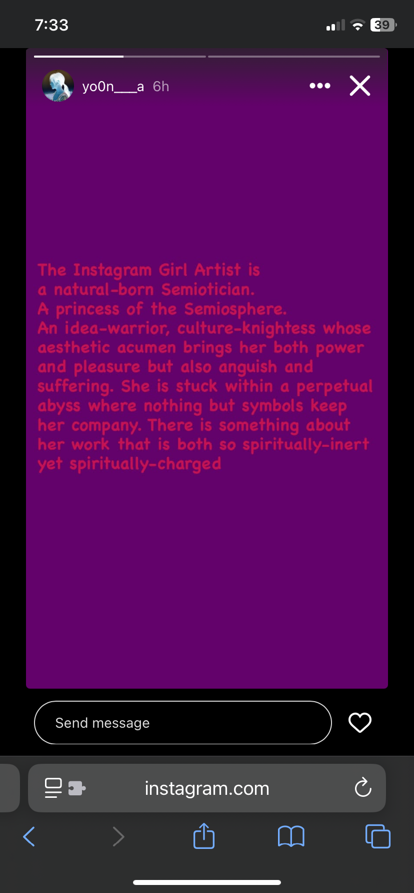
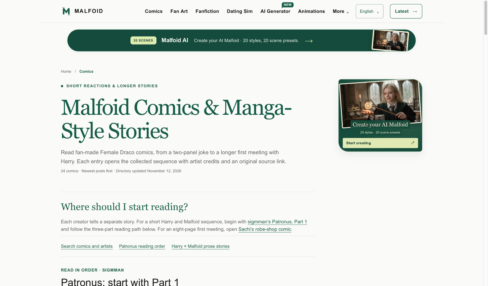
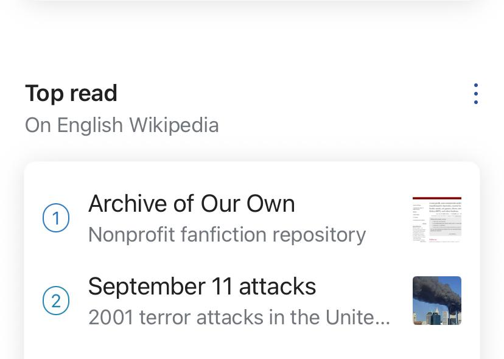
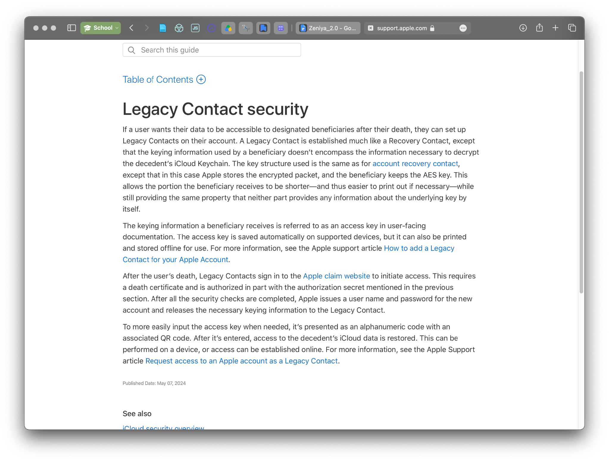
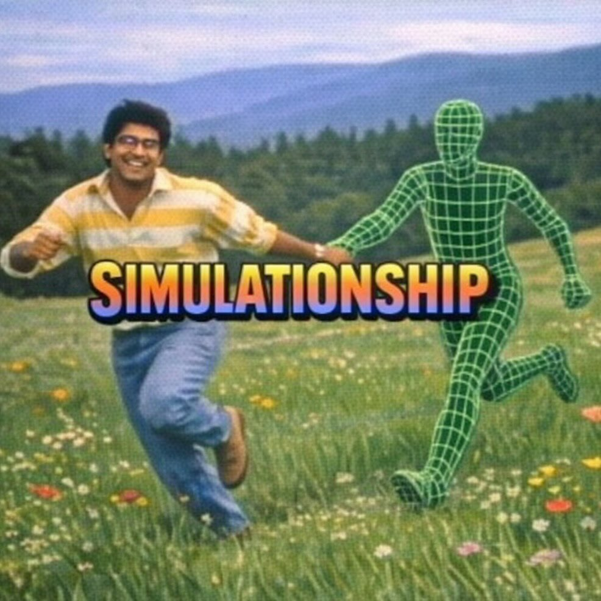

# thesis_workspace
### Abstract 
<i> Cyberspace distorts reality and while not neutral, can be a space that is integral in transforming identity, community and politics. In this thesis I will examine the internet through third space,[...]
 </i>

## <b>Annotated Bibliography</b>

<i>Baudrillard, Jean. 1981. Simulacra and Simulation. University Of Michigan Press.</i>
	  Philosophical essay that goes over  Baudrillard’s theories of the postmodern.  examines the relationships between reality, signs/symbols and society as we begin to construct and understand new[...]

<i>Hiroki Azuma. 2009. Otaku: Japan’s Database Animals. University Of Minnesota Press.</i>  
	A nonfiction essay that goes over Otaku culture as it pertains to consuming media. Azuma examines otaku culture through his own concept of database consumption (“...mode of consumption to gain acce[...]

<i>Nakamura, Lisa. 2008. Digitizing Race Visual Cultures of the Internet. University of Minnesota Press.</i>  
	A nonfiction essay that examines race, gender and ethnicity's impact on digital media. Nakamura uses an ethnographical approach to exploring race and its impact on the internet as well as racialized [...]
	
<i>Nakamura, Lisa. 2026. The Inattention Economy - How Women of Color Built the Internet. U of Minnesota Press.</i>  
	A nonfiction essay that delves into the history of the internet and the roles of women of color played in its production. Additionally, she examines how race, gender and labor shaped information tech[...]

<i>Russell, Legacy. 2020. GLITCH FEMINISM: A Manifesto. Verso.</i>
	  A manifesto that examines the intersections between, race, gender and feminism utilizing  Russell's framework of glitch. Russell’s manifesto treats glitch/error as an alternative way to explor[...]

<i>Sherbert, Biz. 2022. “Intimacy and the Machine: Slouching Towards Girlblogging.” Various Artists, January 28. https://various-artists.com/girlblogger/.</i>  
	A blog post detailing the world of “girlblogging”. This text will be used in sections that pertain to users’ crafting/mixing identities through social networking and constituent  aesthetics (i.[...]

<i> Konior, B. (2026). The dark forest theory of the internet. Polity.<i>
  	Nonfiction essay that primarily focuses on and pushes back on the idea of the internet as an open, non-neutral space. I intend to use the text to strengthen the "politics" section of my framewor[...]

<i>Ables, K. (2019, April 19). How social media killed internet art communities. Artsy. https://www.artsy.net/article/artsy-editorial-rise-fall-internet-art-communities<i>
 Article that focuses on the history of online art communities and their rise and fall during the age of social media. I primarily want to use this as a historical reference to note how the shift f[...]

<i>Solano, Romeo. “The Small Web Is Huge.” Conference presentation at the Seattle GNU/Linux Conference (SeaGL), Seattle, October 23, 2026. Video recording. https://dn711504.ca.archive.org/0/items/[...]
	 A conference presentation that examines the world of the small-web and contrasts it with social media sites/centralized social networking sites. I intend to utilize it as a case study as well as [...]

## Alt Bibliography

*Everything I didn’t or couldn’t cite but still contributed to the framework I was building in the thesis anyway.*

### Place, Purpose, Politics

- Screenshots I took
- Screenshots I took of other screenshots
- [Are.na channels](are.na)
- Words and phrases I came up with
- Words and phrases other people came up with
- Memes (vulgar, relatable, and otherwise)
- Articles that didn’t contribute to the thesis text but relate to its ideas, concepts, and overall ethos
- Videos (MP4 or YouTube)

## Images and Notes

### Figure 1. Instagram girl artist

*Via @Yo0n___a’s Instagram story.*

### Figure 2. Malfoid website screenshot

- [Post-Literate Worlds](https://www.are.na/matthew-k-u8w3uicdgow/post-literate-worlds)
- [What Can Artists Learn from Brainrot?](https://www.sleek-mag.com/article/what-can-artists-learn-from-brain-rot/)

<b>Incel semiotician<b>
The incel semiotician (4chan aesthetics, wojacks) as opposed to Instagram girl artists. The incel semiotician thrives on the grift and speaks through anime waifu profile pictures. Contemporary NEETs. [...]

### Figure 3. Wikipedia Top Read screenshot (11/16/2026)

### Figure 4. [Legacy Contact via iOS Settings](https://support.apple.com/en-us/102631)

### Figure 5. Legacy Contact security screenshot

*Via Apple’s website.*

### Figure 6. Digital Pollution Theory screenshot

*Via Are.na, from user Jasmine Kennedy.*

**Platform shift:** Personal blogging sites → Tumblr → Substack → Instagram text posts.

### Figure 7. Simulationship Meme

*Via Are.na.*

Related links:
- [Hyperlink Hodgepodge](https://www.are.na/sven/hyperlink-hodgepodge)
- [The Small Web Is Huge](https://dn711504.ca.archive.org/0/items/small_web/11787-48384.mp4)
- [Neocities](http://Neocities.org)

### Buy Nothing Facebook groups

- Buy Nothing Hyde Park/Kenwood
- Buy Nothing Bronzeville, South Loop, Kenwood

Life after a dead internet: Zombie-net
If the dead internet theory is true in any capacity,
what comes after? Why’s no one asking?

[The Untold Story of Club Penguin Armies](https://youtu.be/SlCSbwLmWD0?si=dB-JQXjDPGsi6S-7).

### Shortform evolution
Vine → Musical.ly → TikTok → Instagram Reels/YouTube Shorts

### Figure 8. *Because the Internet*, Childish Gambino (2013)

> [“Because of the internet I’m here, because of the internet we’re all here. It’s the language of earth. Everyone keeps saying by this or that year, Mandarin or Spanish will be the most domin[...]

— Childish Gambino, via Exclaim
